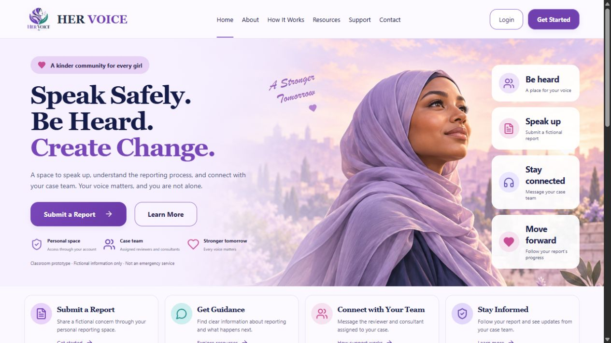
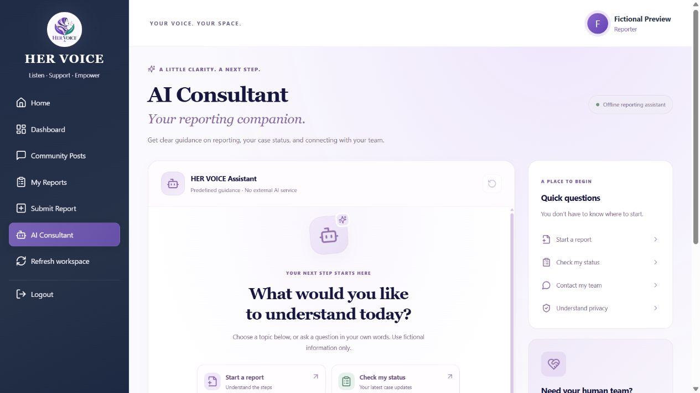

<div align="center">
  
  <h1>HER VOICE</h1>
  <p><strong>Listen. Support. Empower.</strong></p>
  <p>A space for women to raise concerns, follow their cases,<br>and connect with a supportive community.</p>
  <p>
    <a href="#explore-the-platform">Explore</a> &nbsp;·&nbsp;
    <a href="#screenshots">Screenshots</a> &nbsp;·&nbsp;
    <a href="#get-started">Get started</a> &nbsp;·&nbsp;
    <a href="docs/SETUP.md">Full guide</a>
  </p>
  <p><strong>React 19</strong> &nbsp;/&nbsp; Vite &nbsp;/&nbsp; Express &nbsp;/&nbsp; MongoDB</p>
</div>

---

## A voice that leads to support

HER VOICE brings reporting, case coordination, and moderated community discussion into one application. Reporters can submit a concern and communicate with their assigned team, while reviewers and consultants coordinate support through dedicated workspaces.

> **Classroom prototype:** Use fictional information only. This project is not ready for confidential real-world reporting, professional counseling, or emergency response.

## Explore the platform

| Raise a concern | Follow the journey | Find community |
| --- | --- | --- |
| Submit a report in one of five categories and receive a reference code. | Track case progress and exchange private messages with assigned staff. | Read approved summaries, share a general post, and contribute moderated advice. |

| Feature | What it offers |
| --- | --- |
| **Private case workspace** | Ownership checks, reviewer acceptance, consultant assignment, conversations, and internal staff notes. |
| **Specialist support** | Consultant titles, organizations, and supported report categories. |
| **Consent before sharing** | Reporter approval of the exact summary, separate privacy checks, and explicit publication. |
| **Community moderation** | Posts, comments, aliases, contributions, and content reporting. |
| **Reporting assistant** | Offline predefined guidance and shortcuts to the reporter’s latest cases. |
| **Role dashboards** | Dedicated views for reporters, reviewers, consultants, and administrators. |

The reporting assistant uses predefined responses; it does not call an external generative AI service.

## Screenshots

Demonstration screens use fictional data.

<table>
  <tr>
    <td width="50%"><strong>Welcome to HER VOICE</strong><br></td>
    <td width="50%"><strong>Your workspace</strong><br></td>
  </tr>
  <tr>
    <td width="50%"><strong>Community conversations</strong><br></td>
    <td width="50%"><strong>Reporting guidance</strong><br></td>
  </tr>
</table>

## How it works

1. **Report:** Register as a reporter and submit a fictional concern.
2. **Review:** A reviewer claims or accepts the case and coordinates follow-up.
3. **Support:** The reviewer assigns a consultant who supports the report category.
4. **Stay connected:** Track status and message the assigned case team.
5. **Share optionally:** A sanitized summary reaches the community only after consent and privacy review.

Accepting or closing a case does not publish it. General community posts follow their own moderation workflow.

## Get started

**You’ll need:** Node.js 22.12 or later, npm, Git, and a running local MongoDB instance.

```powershell
git clone https://github.com/Rahmomoktar/Hervoice.git
cd Hervoice
```

**Terminal 1 — backend**

```powershell
cd backend
npm ci
Copy-Item .env.example .env
```

Edit `backend/.env`: set your MongoDB connection, a random `JWT_SECRET` of at least 32 characters, and unique administrator credentials. Then run:

```powershell
npm run seed:admin
npm run dev
```

**Terminal 2 — frontend**

```powershell
cd frontend
npm ci
Copy-Item .env.example .env
npm run dev
```

For an existing installation, keep your configured `.env` files. Open the address Vite prints, usually [127.0.0.1:5173](http://127.0.0.1:5173). The backend defaults to port `5000`; Vite proxies `/api` to it.

Log in with your seeded administrator account to create reviewer and consultant accounts. Public registration creates reporters.

**[Read the full setup and workflow guide →](docs/SETUP.md)**

## Who uses HER VOICE?

| Role | Main responsibilities |
| --- | --- |
| **Reporter** | Submit concerns, track owned cases, message assigned staff, and contribute to the community. |
| **Reviewer** | Review and accept cases, coordinate assigned cases, and assign suitable consultants. |
| **Consultant** | Support accepted cases assigned to them, exchange messages, and add internal notes. |
| **Administrator** | Manage staff, specialties, moderation permissions, and community moderation. |

Administrator account management does not grant access to confidential report details through the report APIs. Consultant titles do not verify professional credentials.

## Inside the project

```text
Hervoice/
├── frontend/      React interface, role dashboards, and brand assets
├── backend/       Express API, MongoDB models, and integration tests
├── docs/          Detailed setup, workflows, and prototype limitations
└── README.md      Project overview
```

| Layer | Built with |
| --- | --- |
| Interface | React 19, Vite, CSS, Lucide icons |
| API | Node.js, Express, Mongoose |
| Authentication | JWT bearer tokens, bcrypt password hashing |
| Request protections | Role and ownership checks, validation, Helmet, CORS, request limits |
| Optional invitations | Nodemailer and configured SMTP |

## Development checks

```powershell
# Frontend production build (from frontend/)
npm run build

# Backend integration tests (from backend/, with MongoDB running)
npm test
```

Integration tests use fictional accounts and a separate timestamped test database. See the [testing guide](docs/SETUP.md#testing) for scope and requirements.

## Privacy and project status

Reports are private by default. Community display can use an alias, but account linkage remains in private records; complete anonymity is not guaranteed. Authentication stays in memory, so reloading the browser requires signing in again.

Before real-world use, this prototype needs safeguarding and security review, secure deployment and session design, retention and deletion policies, protected backups, and accessibility testing. See [privacy and prototype limits](docs/SETUP.md#privacy-and-prototype-limits).

No open-source license is currently included.

---

<div align="center">
  <strong>HER VOICE</strong><br>
  Listen · Support · Empower<br><br>
  <a href="https://github.com/Rahmomoktar/Hervoice">View repository</a> &nbsp;·&nbsp;
  <a href="docs/SETUP.md">Documentation</a>
</div>