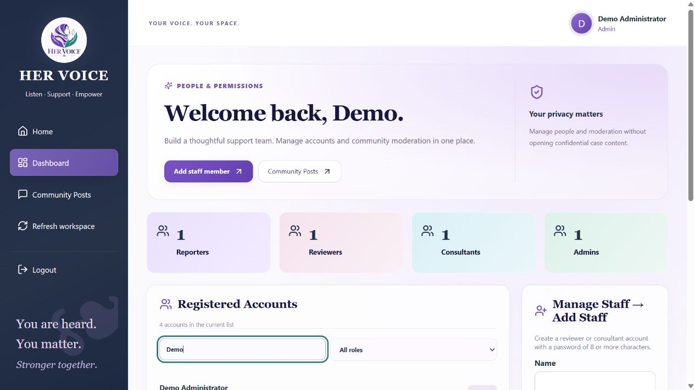
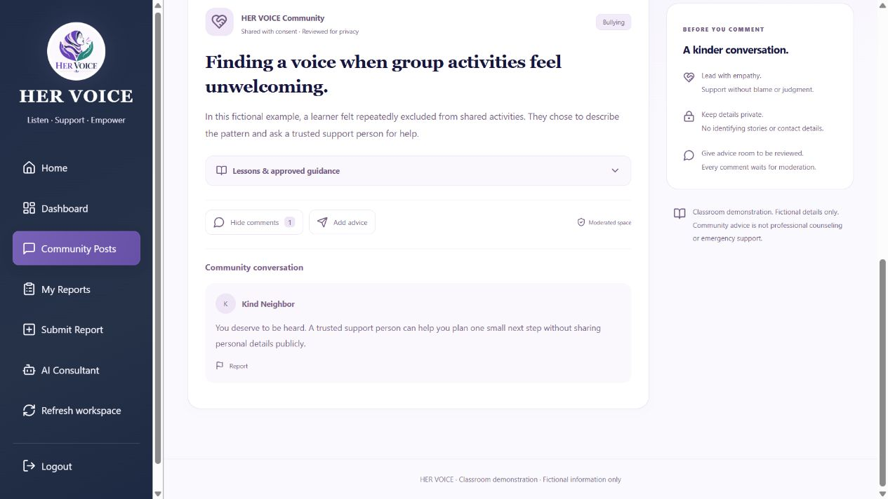

<p align="center">
  
</p>

# HER VOICE

### Women’s Reporting and Community Support Platform

HER VOICE is a web application that helps women submit concerns, follow case progress, and communicate privately with an assigned support team. Reviewers coordinate cases with specialist consultants. Community Posts provides a separate space for approved case summaries, general member posts, and moderated advice.

> **Classroom prototype:** Use fictional information only. HER VOICE is not ready for confidential real-world reporting, professional counseling, or emergency response. Consultant titles do not verify professional credentials, and the app does not automatically contact police or outside organizations.

[Features](#features) · [Roles](#roles-and-permissions) · [Setup](#local-setup) · [Workflows](#using-her-voice) · [Testing](#testing) · [Project structure](#project-structure)

## Features

### Private reporting and case management

- Reporter registration, login, and automatically generated profile codes.
- Five report categories: **Bullying, Harassment, Discrimination, Unfair Treatment, and Other**.
- Written reports of 20–2,000 characters with unique reference codes.
- Case statuses: Submitted, Under Review, Awaiting Clarification, In Progress, and Closed.
- Reviewer claim and acceptance workflows.
- Consultant assignment based on supported report categories.
- Private case conversations for the reporter and assigned staff.
- Consultant internal notes that reporters cannot read.
- Search, status filters, and sorting in the case workspace.

Case acceptance is separate from permission to share a case in the community.

### Specialist consultants

Administrators can configure each consultant’s title, organization or team, and supported report categories.

Available titles include:

- General consultant
- Support worker
- Counselor
- Organization representative
- Police liaison
- Legal advisor
- Health specialist
- Shelter coordinator
- Other specialist

The assigned reviewer chooses an active consultant whose supported categories include the case category. The API validates the match. A title does not grant additional permissions: every consultant can access only accepted cases assigned to that account.

Existing consultants without specialist settings retain the general-consultant defaults. Updating a specialty profile preserves existing assignments; future assignments use the updated categories.

### Community Posts

All community access requires login. The feed contains two distinct types of content:

| Content | How it becomes visible |
| --- | --- |
| Sanitized case summary | The reporter consents to the exact summary version, then the assigned reviewer completes separate privacy checks and explicitly publishes it. |
| General member post | An authenticated reporter writes a separate post, optionally uses an invented alias, and submits it for moderator approval. |

Community features include:

- Category filters and keyword search across shared content.
- Expandable lessons learned and recommendations on case summaries.
- Anonymous or alias-based comments that wait for moderation.
- **My contributions** for a reporter’s own posts and advice.
- Editing and removal of owned member posts and comments.
- Reporting posts or comments for further review.
- Administrator-managed reviewer moderation permissions.

Edits to member posts or advice return them to moderation. Reporting published content hides it pending review. Account linkage stays in private records; the public display does not provide the author’s account ID or email. Complete anonymity is not guaranteed.

“Verified” means reviewed for community sharing. It does not establish that an allegation is true.

### Offline reporting assistant

The AI Consultant page provides predefined responses about reporting, privacy, contacting a case team, and the current reporter’s latest five cases.

It includes quick questions, case-navigation buttons, keyboard submission, and a clear-conversation control. It does **not** use a remote generative AI service or send questions to an external AI provider. Its guidance is not professional counseling or emergency support.

### Dashboards and account management

- Separate dashboards for reporters, reviewers, consultants, and administrators.
- Responsive layouts using purple, lavender, navy, pink, and teal branding.
- Automatic updates without a manual sidebar refresh button.
- Logout confirmation and clearing of private workspace state.
- Administrator creation of reviewer and consultant accounts.
- Specialist profile editing and community moderation permissions.
- Account soft removal that disables access while preserving case history.

Visible dashboards, case lists, case details/messages, community feeds, and sharing-consent panels refresh approximately every **15 seconds**, including when the window regains focus. Expanded community comments refresh every **30 seconds**. Hidden tabs do not poll. These are background API reads, not full page reloads or server-pushed notifications.

## Roles and permissions

| Role | Main permissions | Access boundaries |
| --- | --- | --- |
| **Reporter** | Submit reports, track their own cases, message assigned staff, view community content, and submit posts/advice. | Cannot read another reporter’s private cases or internal staff notes. |
| **Reviewer** | Read submitted cases, claim and accept cases, manage assigned cases, and assign suitable consultants. | Private conversations, changes, internal notes, and sharing approval require the appropriate case assignment. Community moderation requires a separate permission. |
| **Consultant** | Support accepted cases assigned to them, exchange case messages, add internal notes, and update status. | A consultant title never grants access to other consultants’ cases. |
| **Administrator** | Manage accounts, consultant specialties, and community moderation permissions; moderate community content. | Account management does not grant access to confidential report details or case messages through the report APIs. |

Public signup always creates a **reporter**. All roles use the same login page. Administrator setup uses the local seed command, not public registration.

## Technology

| Layer | Technology |
| --- | --- |
| Frontend | React, Vite, CSS, Lucide icons |
| Backend | Node.js, Express |
| Database | MongoDB with Mongoose |
| Authentication | JWT bearer tokens and bcrypt password hashing |
| API protections | Role/ownership checks, validation, Helmet, CORS, and request limits |
| Optional invitation delivery | Nodemailer with SMTP configuration |

## Local setup

### Requirements

- Node.js **22.12 or later** and npm.
- Git.
- MongoDB running locally, normally at `mongodb://127.0.0.1:27017`.
- A terminal such as PowerShell. MongoDB Compass is optional.

### 1. Clone the repository

```powershell
git clone https://github.com/Rahmomoktar/Hervoice.git
cd Hervoice
```

### 2. Configure the backend

From the repository root:

```powershell
cd backend
npm ci
if (!(Test-Path .env)) { Copy-Item .env.example .env }
```

Edit `backend/.env` before starting the server:

| Variable | Purpose |
| --- | --- |
| `PORT` | Backend port. The default is `5000`. |
| `MONGO_URI` | Local database connection, normally `mongodb://127.0.0.1:27017/her_voice_demo`. |
| `JWT_SECRET` | Your own random secret of at least 32 characters. Replace the placeholder. |
| `FRONTEND_ORIGIN` | Comma-separated allowed frontend origins. |
| `ADMIN_NAME` | Name for the first administrator. |
| `ADMIN_EMAIL` | An unused email address for the first administrator. |
| `ADMIN_PASSWORD` | A unique local administrator password. Replace the placeholder. |
| `INVITATION_DELIVERY` | `local` for local invitation links, or `smtp` for configured email delivery. |
| `PUBLIC_FRONTEND_URL` | Frontend address used to build invitation links. |

Generate a random JWT secret if needed:

```powershell
node -e "console.log(require('node:crypto').randomBytes(48).toString('hex'))"
```

Copy that generated value into `JWT_SECRET`. New account passwords require at least **8 characters**, with a maximum of **72 UTF-8 bytes**.

Create the first administrator and start the backend:

```powershell
npm run seed:admin
npm run dev
```

The seed preserves an existing account with the configured email. It does not convert an existing reporter into an administrator or reset existing passwords. Creating an additional administrator requires the seed script’s explicit local-operator override.

Keep `.env` files private. The repository excludes them through `.gitignore`; do not commit credentials or database backups.

### 3. Start the frontend

Open a second terminal at the repository root:

```powershell
cd frontend
npm ci
if (!(Test-Path .env)) { Copy-Item .env.example .env }
npm run dev
```

The default frontend setting is:

```dotenv
VITE_API_URL=/api
```

Open the URL printed by Vite, usually [http://127.0.0.1:5173](http://127.0.0.1:5173). Vite may choose `5174` or another available port if the default is occupied.

Vite proxies `/api` to `http://127.0.0.1:5000`. If you change the backend port, update the proxy in `frontend/vite.config.js`. Restart Vite after changing environment settings. Keep MongoDB and the backend running.

Backend health endpoint: [http://127.0.0.1:5000/api/health](http://127.0.0.1:5000/api/health).

### 4. Create staff accounts

1. Log in with the administrator credentials configured locally.
2. Open **Manage Staff → Add Staff**.
3. Create a reviewer or human consultant with a name, email, and password.
4. For a consultant, select a title and supported report categories. Add an organization/team if appropriate.
5. Use **Edit consultant specialty** to update an existing consultant.

The current Add Staff form creates active accounts directly. It does not send invitation emails.

The backend also supports invitation-based setup. In `local` mode it returns a private setup link without sending email. SMTP mode requires `SMTP_HOST`, `SMTP_PORT`, `SMTP_SECURE`, `SMTP_FROM`, and any required `SMTP_USER`/`SMTP_PASSWORD`. Invitation links are single-use and expire after 24 hours. Email delivery requires separate provider configuration and verification.

## Using HER VOICE

### Private case workflow

1. A reporter registers and submits a fictional concern.
2. A reviewer opens the case and claims or accepts it.
3. The reporter and assigned reviewer exchange private messages.
4. After acceptance, the reviewer assigns a consultant who supports the report category.
5. The consultant opens the assigned case, provides authorized support, and updates progress.
6. The reporter tracks the case in **My Reports** and sees the assigned specialist’s name, title, and organization.

Closing or accepting a case never publishes it.

### Sharing a case summary

1. The assigned reviewer accepts the case and opens **Optional community sharing**.
2. The reviewer writes a separate sanitized summary, generalized situation, lessons, and recommendations. Remove names, contact details, precise locations, and indirect identifiers.
3. The reporter reads the exact saved version and optionally gives consent.
4. The reviewer completes both privacy checks and explicitly publishes the summary.
5. Signed-in community members can view it in **Community Posts**.

Editing a case summary unpublishes it and invalidates previous consent and privacy approval. The reporter can withdraw consent. Removing content from the library cannot recall copies that someone already read or saved.

### Member posts, comments, and moderation

Reporters can submit a separate general community post or offer advice on an approved post. Use fictional information and an invented alias, or leave the alias blank for **Anonymous**.

Posts and comments remain private until moderation approves them. Authors can manage their own contributions. Administrators and reviewers with moderation permission review privacy and conduct before publication and can remove inappropriate content.

A case summary cannot bypass its consent workflow through ordinary post moderation.

## Pages

| URL | Page |
| --- | --- |
| `/` | Public home page |
| `/register` | Reporter registration |
| `/login` | Shared login for all roles |
| `/dashboard` | Dashboard for the signed-in role |
| `/reports` | Cases available to the current role |
| `/reports/new` | Reporter submission form |
| `/reports/:id` | Authorized case details and conversation |
| `/community` | Community Posts, contributions, and moderation tools |
| `/ai-consultant` | Reporter’s offline reporting assistant |
| `/accept-invitation` | Staff invitation activation |

Authentication stays in memory. A browser reload or a new tab requires login again for protected pages. Background automatic updates do not reload the page or end the session.

## Project structure

```text
Hervoice/
├── backend/
│   ├── src/
│   │   ├── middleware/       # Authentication and role checks
│   │   ├── models/           # Users, reports, messages, community content
│   │   ├── routes/           # Auth, reports, messaging, staff, community, assistant
│   │   ├── utils/            # Access helpers and specialist configuration
│   │   ├── createAdmin.js    # Local administrator setup
│   │   └── server.js         # API server and MongoDB connection
│   ├── tests/               # Fictional-data integration coverage
│   └── .env.example
├── frontend/
│   ├── public/              # Logo and homepage illustration
│   ├── src/
│   │   ├── components/      # Shared navigation, forms, tables, and case tools
│   │   ├── context/         # In-memory authentication
│   │   ├── lib/             # API client, navigation, and automatic refresh
│   │   ├── pages/           # Role dashboards and application pages
│   │   └── App.jsx          # Application navigation and workspace actions
│   └── .env.example
└── README.md
```

## Testing

Run backend integration tests with local MongoDB available:

```powershell
cd backend
npm test
```

Build the frontend from the repository root:

```powershell
cd frontend
npm run build
```

For a local preview of the production bundle, run `npm run preview` from `frontend` after building it. The backend still needs to run separately.

Integration tests use port `5099`, fictional accounts, and a separate `her_voice_test_<timestamp>` MongoDB database. They do not wipe the application database. Test databases remain available for inspection.

Coverage includes authentication, ownership and role boundaries, reviewer acceptance, consultant specialties, case messages and internal-note privacy, community consent/version checks, post and comment moderation, account removal, rate limits, and persistence across backend restarts.

A successful build or API suite does not replace full browser, mobile, accessibility, security, or safeguarding review.

## Privacy and prototype limits

- Submitted reports are private by default. Community content uses separate records and restricted response fields.
- The backend checks ownership and roles on API requests, including requests made with guessed case IDs.
- Profile codes identify records; they are not passwords.
- Case conversations belong to the reporter and assigned staff. Reporters cannot read internal consultant notes.
- Anonymous display does not remove account linkage or technical records.
- Account removal disables access and preserves case/message history. It is not personal-data erasure.
- Request limits use process memory and reset when the backend restarts.
- Current list endpoints have limits or lack full pagination. Dashboard totals reflect the records returned.
- Existing bearer tokens have no individual revocation workflow. Disabling an account blocks its authenticated access.
- The app does not dispatch emergencies or automatically forward a case to an outside organization or police service.

Before real-world use, the project needs professional safeguarding/security review, secure deployment and session design, consent and escalation procedures, audit logging, data retention/deletion policies, protected database/backups, shared abuse controls, and independent accessibility testing.

Production hosting also needs an appropriate `/api` reverse proxy and SPA fallback to `index.html` for frontend routes. Local development settings are not a production deployment configuration.

## Screenshots

The previews below show demonstration data.

### Dashboard



### Community discussion



## Brand

The interface uses purple `#6C4AB6`, lavender `#F3EDFF`, navy `#263248`, pink `#E9D5E8`, teal `#287D72`, and a light background `#FAF9FD`. The supplied HER VOICE logo is available in `frontend/public/her-voice-logo.png`.

## Repository

[github.com/Rahmomoktar/Hervoice](https://github.com/Rahmomoktar/Hervoice)

No open-source license file is included at the time of this documentation update. Add an appropriate license before describing the project as freely licensed.
